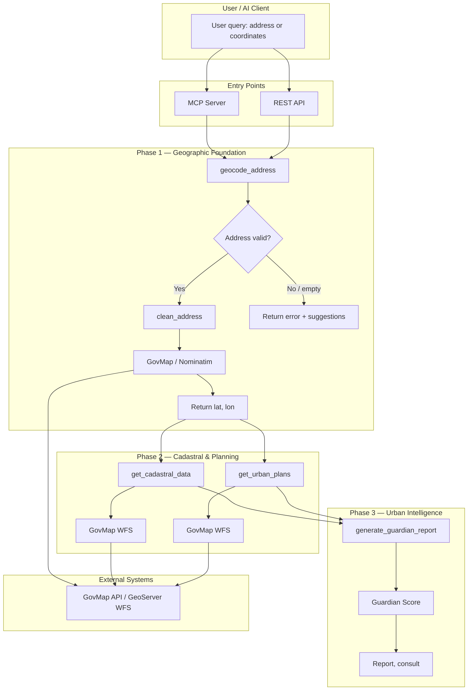
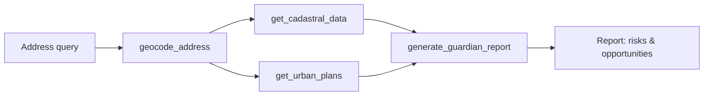
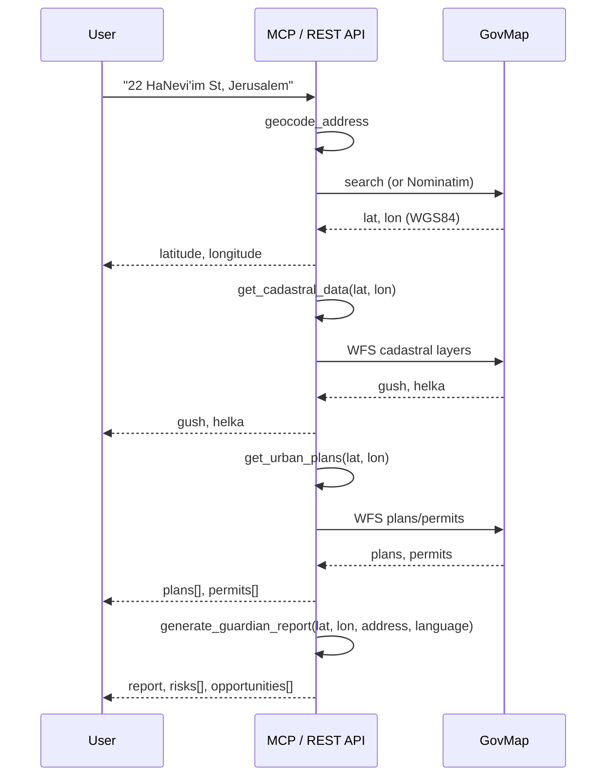
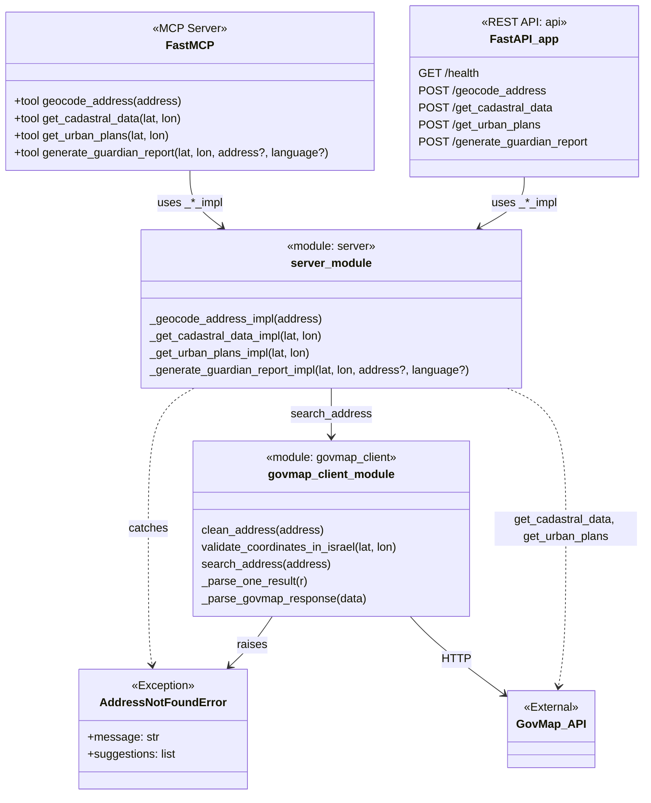
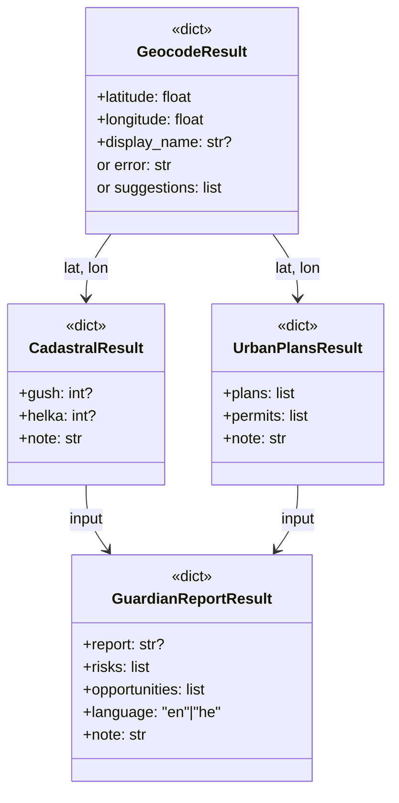

# Urban Guardian (Israel)

> **⚠️ Educational / demonstration project only — not advice, no warranty, use at your own risk.**
> Output is not legal, planning, engineering, appraisal, brokerage or investment advice. Data comes from third-party sources, may be incomplete or wrong, and an empty result does not mean that no permit, plan or restriction exists. See [DISCLAIMER.md](./DISCLAIMER.md) (English + עברית).

**MCP server & REST API for Israeli real estate intelligence** — geocoding, cadastral data, urban planning, and bilingual advisory reports from official government spatial sources.

---

## Overview

Urban Guardian is a **Model Context Protocol (MCP) server** that exposes tools for **AI agents and applications** to query Israeli addresses and receive structured data: WGS84 coordinates, block/parcel (Gush/Helka), zoning plans, building permits, and synthesized risk/opportunity reports. A **REST API** mirrors the same operations for integration and manual testing. The system is designed for **production-style** architecture: shared implementation between MCP and REST, comprehensive tests (unit, E2E, integration with real GovMap/Nominatim APIs), and clear separation of client logic, server tools, and API layer.

**Audience:** Built as a portfolio project demonstrating **backend engineering** (API design, external API integration, validation, error handling) and **AI/LLM integration** (MCP protocol, tool design for LLM consumption).

---

## Features

- **MCP server** — Six tools: `geocode_address`, `get_cadastral_data`, `get_urban_plans`, `get_spatial_mining`, `get_multi_radius_search`, `generate_guardian_report` (FastMCP, stdio).
- **REST API** — Same operations over HTTP (FastAPI) with validation and 400 on invalid input.
- **GovMap & geocoding** — Address normalization, WGS84 validation (Israel bbox), GovMap client with configurable URL; **Nominatim (OSM) fallback** when GovMap returns non-JSON or no results (Israel only).
- **Structured responses** — GeoJSON and flat dict parsing; “did you mean?” suggestions on address-not-found.
- **🔍 FULL API TRANSPARENCY** — Every response includes complete raw data from GovMap/Nominatim APIs in `raw_api_response` and `raw_api_data` fields. Zero filtering — users receive 100% of government API responses including all attributes, features, and metadata.
- **Testing** — Unit (mocked), functional, E2E (“Concerned Homebuyer” scenario), integration (real GovMap getTypes, Nominatim), REST API tests; pytest markers for unit vs integration.
- **Postman** — Collection for all REST endpoints and error cases.

---

## Tech Stack

| Layer        | Technology |
|-------------|------------|
| MCP server  | [FastMCP](https://gofastmcp.com) (Python), stdio |
| REST API    | FastAPI, Uvicorn |
| HTTP client | httpx |
| Geocoding   | GovMap (configurable); Nominatim fallback when GovMap unavailable |
| Testing     | pytest, pytest-cov |
| Package/env | uv, pyproject.toml (Python ≥3.10) |

**Data sources:** All planning and cadastral data come from **GovMap only** (GeoServer WFS and GovMap APIs). The system is fully implemented and working via GovMap.

### Implementation status

| Tool / API | Status |
|------------|--------|
| **geocode_address** | GovMap first; **Nominatim (OSM) fallback** when GovMap is unavailable or returns non-JSON (e.g. HTML). Result may include `"source": "nominatim"` when fallback was used. |
| **get_cadastral_data** | **GovMap WFS** cadastral layers (גוש/חלקה) — Identify at point; returns block (Gush) and parcel (Helka). |
| **get_urban_plans** | **GovMap WFS** plans/permits at coordinates (תב"ע, רצף מגרשים). |
| **get_spatial_mining** | **Station 3** — Plans/permits at 100 m, 500 m, 1000 m radii (permits, תב"ע, infrastructure context). |
| **get_multi_radius_search** | **Multi-Radius Search** — Layer-based radii: bedroom 50 m, permits 100 m, lifestyle 300 m, plans 500 m, value 800 m; summary flags for the Brain. |
| **generate_guardian_report** | **Guardian Score** — Weighted analysis (pros, risks, status) from cadastral + multi-radius plans/permits + **noise + TAMA + transport**; returns score 0–100, consult, report, risks, opportunities, plus detailed environmental data. |

---

## Architecture

### Production line (4 stations)

End-to-end flow from user query to advisory report:

| Station | Name | Input | What happens | Output |
|--------|------|------|----------------|--------|
| **1** | Geocoding | "דיזנגוף 100, תל אביב" | GovMap (or Nominatim) converts address → point | Lat, Lon, display name |
| **2** | Cadastral (Identify) | Lat, Lon | GovMap WFS on גושים/חלקות layers | Gush (גוש), Helka (חלקה) — Tabu legal ID |
| **3** | Spatial mining | Lat, Lon | GovMap WFS plans/permits at 100 m, 500 m, 1000 m | `within_100m`, `within_500m`, `within_1000m` |
| **4** | The Brain | Raw JSON from 1–3 | Weighted analysis (Guardian Score) | Report: score, risks, opportunities, consult |

Tools: **Station 1** → `geocode_address`; **Station 2** → `get_cadastral_data`; **Station 3** → `get_urban_plans` + `get_spatial_mining` + `get_multi_radius_search` (layer-based radii); **Station 4** → `generate_guardian_report` (Guardian Score — weighted analysis).

### Guardian Score (Weighted Analysis)

Station 4 aggregates three vectors into a **Guardian Score** (0–100) and a short **consult**:

- **Pros (תועלת):** Cadastral identified, no permits within 100 m, open space / residential zoning within 500 m, diverse plans.
- **Risks:** Construction permits within 50 m / 100 m (noise), proposed roads, heavy commercial nearby.
- **Status:** Planning clarity (parcel identified) or unidentified / restriction.

The **decision matrix** (points added/subtracted per condition) is implemented in `guardian_score.py` and documented for AI use in [docs/GUARDIAN_SCORE_MATRIX.md](docs/GUARDIAN_SCORE_MATRIX.md). That document doubles as a **system prompt** so an AI (e.g. Claude) can apply the same rules when it has raw MCP output. The API returns `guardian_score`, `consult`, `report`, `risks`, `opportunities`, and optional `score_breakdown`, `status`, `status_note`.

### Activity flow (end-to-end)

User or AI client sends an address (or coordinates). Entry points are the **MCP server** or **REST API**. Phase 1 geocodes the address; Phase 2 fetches cadastral and planning data; Phase 3 produces the guardian report.



### Simplified flow (happy path)



### E2E sequence: “Concerned Homebuyer”



### Class / module structure

MCP tools and REST endpoints share the same `_impl` functions. The only custom exception is `AddressNotFoundError` in the GovMap client.



### Data flow (response shapes)



---

## Project structure

| Path | Role |
|------|------|
| `server.py` | MCP server (FastMCP): tool definitions and `_*_impl` implementations. |
| `govmap_client.py` | GovMap client: address normalization, validation, search, response parsing, `AddressNotFoundError`. |
| `api.py` | REST API (FastAPI): `/health`, `/geocode_address`, `/get_cadastral_data`, `/get_urban_plans`, `/generate_guardian_report`. |
| `tests/` | Unit, functional, E2E, integration, and REST API tests. |
| `postman/` | Postman collection for the REST API. |
| `docs/` | Additional documentation (e.g. PROJECT_OVERVIEW). |
| `pyproject.toml` | Project metadata and dependencies (uv). |

---

## Getting started

**Prerequisites:** Python ≥3.10, [uv](https://docs.astral.sh/uv/) (recommended) or pip.

### Run the MCP server

```bash
# With uv (creates .venv and installs deps from pyproject.toml)
uv run server.py
```

With pip:

```bash
pip install -r requirements.txt
fastmcp run server.py
```

### Run the REST API

```bash
uvicorn api:app --reload --port 8000
```

- **Health:** `GET http://localhost:8000/health`
- **Postman:** Import [postman/Urban_Guardian_API.postman_collection.json](./postman/Urban_Guardian_API.postman_collection.json); base URL `http://localhost:8000`.

### REST endpoints (summary)

| Method | Endpoint | Body (JSON) |
|--------|----------|-------------|
| GET | `/health` | — |
| POST | `/geocode_address` | `{"address": "22 HaNevi'im St, Jerusalem"}` |
| POST | `/get_cadastral_data` | `{"latitude": 31.784, "longitude": 35.221}` |
| POST | `/get_urban_plans` | `{"latitude": 31.784, "longitude": 35.221}` |
| POST | `/get_spatial_mining` | `{"latitude": 31.784, "longitude": 35.221}` (optional: `radius_permits_m`, `radius_plans_m`, `radius_infrastructure_m`) |
| POST | `/get_multi_radius_search` | `{"latitude": 31.784, "longitude": 35.221}` — layer-based radii (50/100/300/500/800 m), summary flags |
| POST | `/generate_guardian_report` | `{"latitude": 31.784, "longitude": 35.221, "address": "...", "language": "en"}` |

### GovMap configuration

GovMap endpoints and layer names are documented in **[docs/GOVMAP_INTEGRATION.md](docs/GOVMAP_INTEGRATION.md)** (official API docs at `api.govmap.gov.il/docs` may return Access Denied). Optional environment variables:

| Variable | Default | Description |
|----------|---------|-------------|
| `GOVMAP_SEARCH_URL` | `https://www.govmap.gov.il/Searching/SearchRest.ashx` | Geocoding search endpoint. |
| `GOVMAP_PLAN_LAYERS` | `govmap:layer_tabaot,govmap:layer_retzefmigrashim,govmap:layer_retzefgvulot` | Comma-separated WFS layer names for plans (תב"ע). |
| `GOVMAP_CADASTRAL_LAYERS` | `govmap:layer_parcel_all,...` | Comma-separated WFS layer names for cadastral (גוש/חלקה). |
| `GOVMAP_PERMIT_LAYERS` | (empty) | Comma-separated layer names for building permits (היתרי בנייה). |
| `GOVMAP_NOISE_LAYERS` | `govmap:layer_svivanoiseday,govmap:layer_svivanoisenight` | Noise pollution layers (day/night). |
| `GOVMAP_TAMA_LAYERS` | `govmap:layer_tamat_investor_informetion,...` | TAMA 38 urban renewal layers. |
| `GOVMAP_TRANSPORT_LAYERS` | (empty) | Transport infrastructure layers (metro, rail). |
| `GOVMAP_CONSERVATION_LAYERS` | (empty) | Conservation & heritage layers (municipal). |
| `GOVMAP_HAZARDS_LAYERS` | (empty) | Hazard layers (high voltage, environmental). |

---

## Testing

```bash
# All tests
uv run pytest tests/ -v
# or: pip install -r requirements.txt && python -m pytest tests/ -v

# Unit only (no real external APIs)
uv run pytest -m "not integration" -v

# Integration (real GovMap getTypes, Nominatim)
uv run pytest tests/test_integration_real_api.py -v
```

| Test module | Coverage |
|-------------|----------|
| `test_geocode.py` | GovMap client: clean_address, validate_coordinates, search_address (valid, not found, suggestions, empty, GeoJSON); geocode tool success/error. |
| `test_server.py` | Cadastral, urban plans, guardian report (shape, WGS84, language, address); MCP tool registration (all four tools). |
| `test_e2e.py` | E2E “Concerned Homebuyer”: full workflow; success criteria (precision, actionable output, bilingual); report structure. |
| `test_integration_real_api.py` | Real GovMap getTypes, GovMap URL reachable, Nominatim geocode (Jerusalem, Tel Aviv), E2E with real geocode (`@pytest.mark.integration`). |
| `test_api.py` | REST API: health, geocode/cadastral/plans/report (success + invalid body → 400). |

---

## Phases (roadmap)

| Phase | Name | Status |
|-------|------|--------|
| **1** | Geographic Foundation (GovMap geocoding, ITM→WGS84) | ✅ Functional |
| **2** | Cadastral & Planning (Gush/Helka, תב"ע, permits) | GovMap WFS/APIs |
| **3** | Urban Intelligence (risk/opportunity synthesis, bilingual report) | 📋 Logic definition |
| **4** | Environmental & Infrastructure (proximity, flood/seismic) | 🚀 Planned |

---

## Example: AI / Claude use case

**User:** *“Analyze the development potential of HaYarkon 10, Tel Aviv.”*

1. **Geocode** — `geocode_address("HaYarkon 10, Tel Aviv")` → lat, lon (WGS84).
2. **Cadastral** — `get_cadastral_data(lat, lon)` → block (Gush), parcel (Helka).
3. **Planning** — `get_urban_plans(lat, lon)` → plans and permits (GovMap WFS).
4. **Report** — `generate_guardian_report(lat, lon, address=..., language="en")` → Guardian Score (0–100), consult, report, risks, opportunities, score_breakdown, status.

The MCP server exposes these as tools so an AI agent can call them in sequence; the REST API exposes the same operations for HTTP clients.

---

## Documentation

- **[PROJECT_OVERVIEW.md](./PROJECT_OVERVIEW.md)** — Detailed phase breakdown, data sources, and tool semantics (suitable as a system prompt or project brief).
- **Diagrams** — Activity flow, sequence, and class diagrams are in this README (Mermaid). They render on GitHub, GitLab, and in editors with Mermaid support; you can also paste blocks into [mermaid.live](https://mermaid.live) to edit or export.

---

## License, disclaimer and data sources

- **Code:** [MIT License](./LICENSE) — provided "AS IS", without warranty. Educational and portfolio project; see [DISCLAIMER.md](./DISCLAIMER.md).
- **Not affiliated** with the State of Israel, the Survey of Israel, GovMap, MAVAT or OpenStreetMap.
- **Data is not covered by the MIT license.** Geospatial data © Survey of Israel (GovMap) and geocoding fallback data © [OpenStreetMap contributors](https://www.openstreetmap.org/copyright) (ODbL). Check each provider's current terms before running this against their services; in particular, GovMap terms may restrict commercial use, automated access and redistribution. This repository does not include GovMap data dumps.
- **Nominatim:** the public instance is rate-limited to 1 request/second (enforced in code) and requires a descriptive User-Agent. Do not use this project for bulk geocoding. Run your own instance for anything beyond light, personal use.
- **Do not run this as a public service** or present its output as advice to third parties without legal review.
